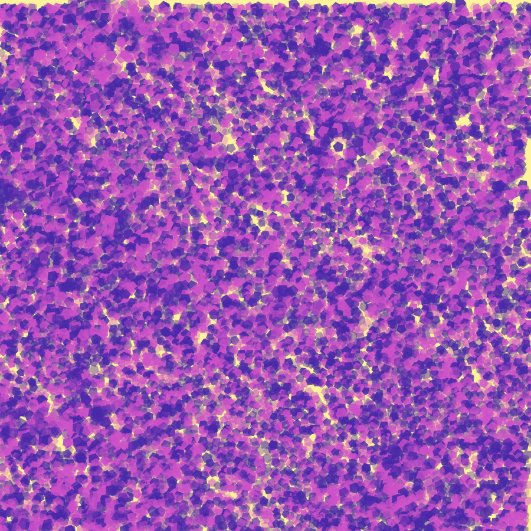
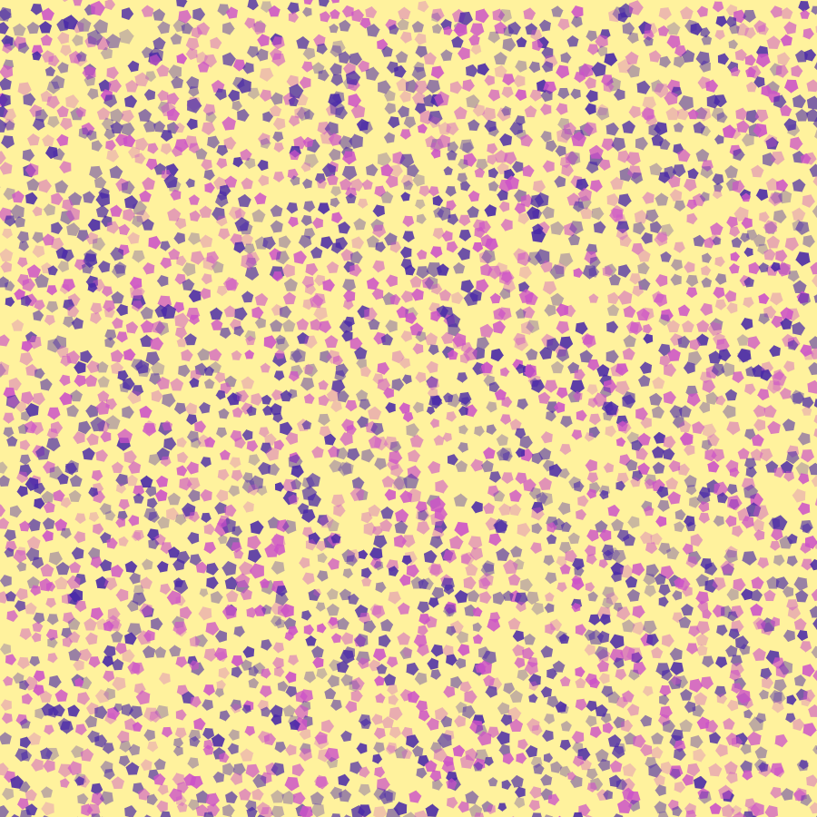
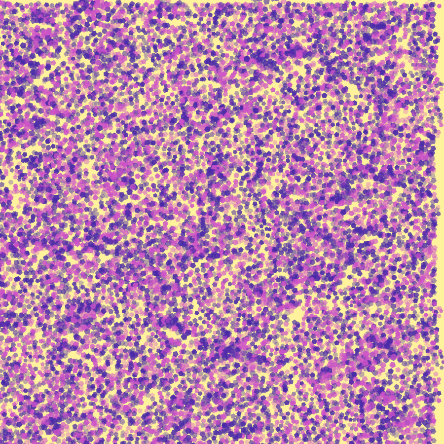
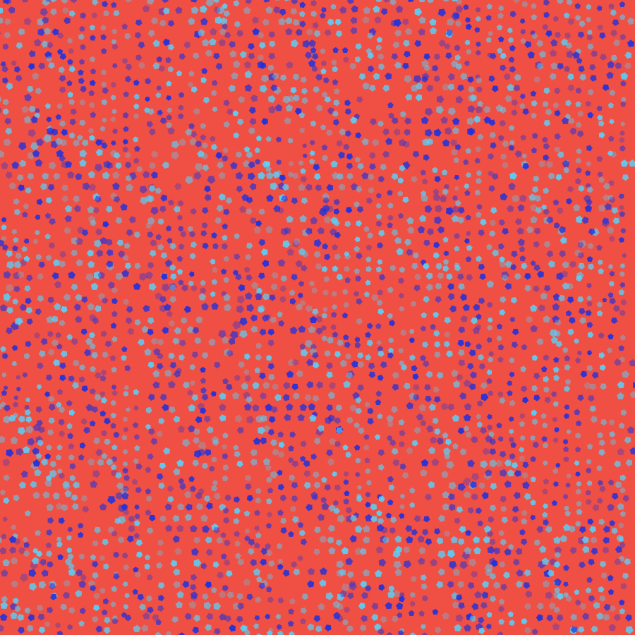
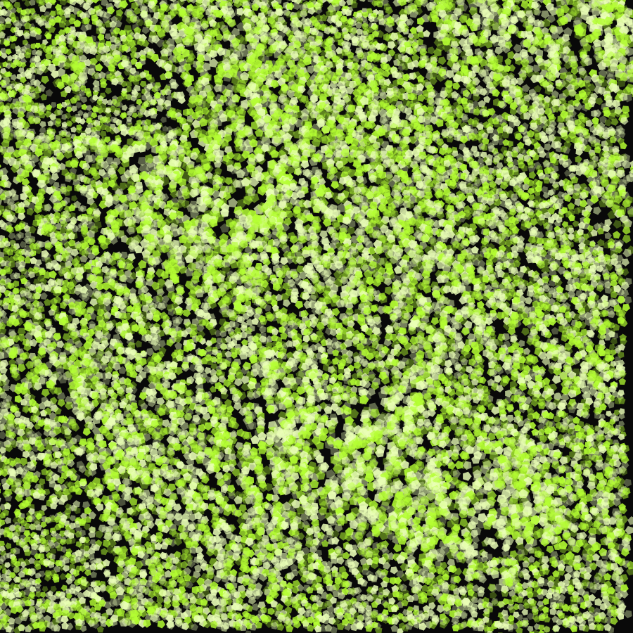

# perlin.playground

A browser-based procedural generative playground built with React, TypeScript, and p5.js.

## Some Graphics generated using perlin.playground

<p align="center">
  
  
</p>

<p align="center">
  
  
</p>

<p align="center">
  
</p>

## Run locally

```bash
npm install
npm run dev
```

Create a production bundle with `npm run build`, and run the unit checks with `npm test`.

## Included capabilities

- A seeded, deterministic improved-gradient Perlin engine: normalized gradient vectors, corner dot products, quintic fade interpolation, and cached permutation tables. It supports 2D fields, 3D time-continuous fields, and normalized fBm (octaves, persistence/falloff, and lacunarity).
- Raw, high-contrast, contour-map, fBm, animated, and threshold reference visualizations alongside the existing flow, displacement, density, contour, stipple, and vector artwork modes.
- Cartesian, staggered, jittered, and polar grids; editable masks and locally processed image masks.
- Playback/scrubbing controls, named built-in presets, locally persisted custom presets, randomization, and undo/redo.
- High-resolution offscreen PNG/JPEG exports, deterministic SVG geometry, and validated JSON configuration import/export.

Image masks intentionally remain session-scoped and are not stored in local storage.
